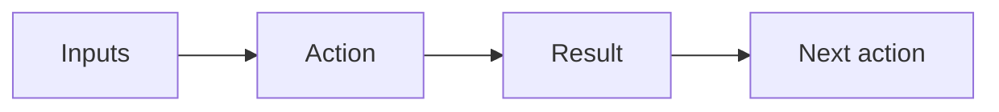

# Express the instructions

## Goal

Choose concise Markdown forms that preserve the meaning of the procedure and its technical content.

## Procedure

### Grouped choices

Choose one form or combine forms according to the information being expressed:

* **Connected ideas:** paragraph or subsection.
* **Independent items:** bulleted list or nested list.
* **Sequential actions:** numbered list or numbered step headings.
* **Comparable alternatives:** table or separately labeled paragraphs.

Group options on one line when they share a purpose and need no individual explanation. Distinguish illustrative choices from exhaustive values.

### Conditions and alternatives

Use a direct conditional instruction when the condition and its consequence can be expressed together. If the condition is uncertain, investigate it or preserve the uncertainty.

Use named alternatives when their consequences require different explanations.

**Update the existing procedure.** Choose this when its responsibility remains unchanged and the revision fits the current scope.

**Separate the capability.** Choose this when the new work has a distinct purpose, selection condition, or responsibility.

Use compact labels to contrast appropriate and inappropriate instructions:

**Avoid:** Review the result thoroughly.

**Prefer:** Compare the result with the agreed requirements and identify unsupported claims.

### Exact content and examples

Use fenced code blocks for commands, configuration, literal content, or syntax that must remain unchanged. Identify the language when applicable.

```sh
python validate.py
```

An indented code block can also preserve literal text:

    This line is literal content, not another instruction.

Use a longer outer fence when demonstrating Markdown source containing another fence:

````markdown
Run the project's existing validation command:

```sh
python validate.py
```
````

Use escaping to show literal markers such as \* or \# without applying their formatting.

When a result has a defined format, show its structure. Include placeholders only for information the agent must determine:

```markdown
## Finding

**Observed:** [What the evidence establishes]

**Expected:** [The applicable requirement]

**Follow-up:** [The action supported by the comparison]
```

Use a filled example when the distinction is difficult to infer from the format alone.

**Observed:** The source states that the limit is optional.

**Expected:** The revised text preserves that qualification.

**Follow-up:** Restore the optional condition in the revised text.

### Links and visual information

Link supporting material at the action that needs it.

* [Organize the procedure](2-organize-procedure.md#navigation-and-dependencies) links to a relevant section.
* [The working example][example] uses a reference-style link.
* An autolink such as <https://github.com/LeszekKantorek/agent-skills> exposes its destination directly.

[example]: ../working-example.md

Use images when visual information contributes to the result. Provide relevant alternative text.

```markdown
[Validation report](validation/report.md)

```

---

### Renderer-specific forms

Use extensions when the intended renderer supports them.

> [!NOTE]
> Required instructions must remain understandable even when an extension is rendered as ordinary text.

A diagram can express dependencies:



A formula can express a precise relationship. For example, $r = n_{completed}/n_{required}$ represents the completion ratio when the denominator is nonzero.

<details>
<summary>Supplementary formatting variants</summary>

Setext headings, different bullet markers, and different code fence markers express equivalent structures. Choose a consistent form.

```markdown
Title
=====

Section
-------

- Unordered item
+ Unordered item
* Unordered item

~~~text
Literal content
~~~
```

</details>
