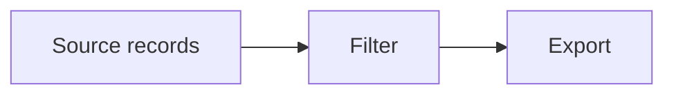

# Express technical content

## Goal

Demonstrate forms that preserve exact syntax, examples, technical structures, and references.

## Examples

### Literal content

Use inline code for exact identifiers such as `record_id`, file paths such as `report.json`, or commands such as `git status`.

Fenced blocks preserve multiline commands and configuration:

```sh
python -m json.tool report.json
```

```yaml
name: record-inspector
description: Inspect tabular records for missing values and inconsistent field types. Use for structured records, not free-form log messages.
```

A text block can represent a directory structure:

```text
exports/
├── records.csv
└── schema.json
```

An indented code block also preserves literal text:

    status=active

Use escaping to show literal markers such as \* or \# without applying their formatting.

A longer outer fence can contain another fence when demonstrating Markdown source:

````markdown
Inspect the JSON syntax:

```sh
python -m json.tool report.json
```
````

### Input and output examples

A filled pair makes a transformation concrete.

**Input:** `2026-04-10T12:00:00+02:00`

**Output:** `2026-04-10T10:00:00Z`

A template illustrates the shape of a result when that shape matters:

```markdown
## Export summary

**Record count:** [number]

**Missing values:** [findings]
```

**Filled example — Export summary**

**Record count:** 240

**Missing values:** 3 records have no timestamp.

### Links and quotations

A link can point directly to the relevant material.

* [Conditional branches](3-express-sequences-and-dependencies.md#conditional-branches-and-corrections) links to a section.
* [Working example][example] illustrates reference-style links.
* <https://github.com/LeszekKantorek/agent-skills> is an autolink.

[example]: ../working-example.md

A blockquote distinguishes quoted evidence or a qualification:

> The export contains selected records only.

Image syntax includes a destination and descriptive alternative text. These literal examples do not require external resources:

```markdown
[Export report](reports/export.md)

```

---

### Renderer-specific forms

A horizontal rule separates supplementary material from the preceding section. Extensions can express additional relationships when the renderer supports them.

> [!NOTE]
> A renderer may display extension syntax as plain text.

A Mermaid diagram can describe a technical relationship:



A mathematical expression can state a relationship precisely: $r = n_{valid}/n_{total}$ for $n_{total} > 0$.

<details>
<summary>Equivalent syntax variants</summary>

Setext headings, alternate list markers, and tilde fences express familiar Markdown structures.

```markdown
Title
=====

Section
-------

- Unordered item
+ Unordered item
* Unordered item

~~~text
Literal content
~~~
```

</details>
