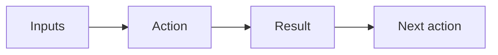

# Writing instructions in Markdown

Use Markdown to express the relationships between instructions, conditions, decisions, and results. Choose forms that make these relationships clear without adding unnecessary text.

This document demonstrates the forms through its own content. Its sections are not a template for skills.

## Express the intended action

Name the action, its object, and the conditions that affect its result. A connected explanation or conditional instruction can remain a short paragraph.

If several actions depend on the same condition, state the condition once and keep the actions within its scope. Do not repeat it beside every action.

Prefer ~~Analyze the sources carefully~~ **Identify which claims describe the same behavior under the same conditions.** The latter specifies a comparison the agent can perform.

Use **bold** for meaningful distinctions and *italics* for emphasis or qualifications. Use inline code for exact identifiers, paths, values, and commands such as `SKILL.md`.

## Organize the information

### Headings and scope

Use headings to separate subjects and establish the scope of subordinate content. Give each section a purpose rather than a decorative label.

#### Subsections

Use deeper headings when a substantial section needs further subdivision. Preserve the hierarchy and keep the content under the heading that governs it.

### Independent instructions

Use bullets when the instructions do not depend on a particular order.

* Group related instructions under their common subject.
* Keep qualifications and exceptions beside the instruction they affect.
* Introduce a list when its purpose is not already apparent from the heading.
* Use nested items when the distinction needs more detail:
  * Requirements define conditions the result must satisfy.
  * Evidence establishes what is supported and what remains uncertain.

### Grouped choices

Choose one form or combine forms according to the information being expressed:

* **For connected ideas:** paragraph or subsection.
* **For independent items:** bulleted list or nested list.
* **For sequential actions:** numbered list or numbered step headings.
* **For comparison:** table or separately labeled alternatives.

Group options on one line when they share a purpose and need no individual explanation. State whether the available choices are exhaustive or illustrative when the distinction matters.

## Describe a procedure

1. Identify the intended result and available inputs.

2. Determine which actions and decisions are needed.

   Preserve the scope of the step by indenting its subordinate content.

   * Identify the conditions that change the next action.
   * Keep unresolved conditions explicit.

   When conditions need comparison, keep the table within the step:

   | Finding | Next action |
   | --- | --- |
   | Confirmed cause | Apply the supported correction. |
   | Competing explanations | Perform a distinguishing check. |
   | Missing evidence | Preserve the unresolved question. |

   If none of the findings fits, identify the relevant condition rather than forcing it into an existing row.

3. Check whether the result satisfies the intended outcome.

Use numbered steps when order matters. For substantial steps, use numbered headings instead so that paragraphs, lists, and decision aids can remain within the step's scope.

A step must leave a result that the following action can actually use. Do not instruct the agent to apply a confirmed correction when the preceding action may have produced competing explanations.

## Describe alternatives

Use separate labeled paragraphs when the options require different explanations.

**Direct conditional instruction**

Use this form when a condition and its consequence can be expressed together. If the condition is not established, investigate it or retain the uncertainty.

**Decision table**

Use this form when alternatives share comparable criteria, fields, or consequences. Keep interpretation guidance beside the table. Do not repeat the same decision in a preceding list.

## Preserve distinctions and boundaries

Use a short introduction to distinguish open categories from closed contract values.

Useful knowledge can include:

* Requirements, decisions, and procedures.
* Explanations, evidence, and unresolved questions.

Preserve other contributions when these categories do not describe their role.

For a protocol with a closed status enumeration, accept only:

* `active`
* `paused`
* `closed`

Do not extend the set without changing the contract.

> A missing status is not equivalent to `paused`.

Use blockquotes for quoted material or distinct qualifications. Do not hide mandatory actions inside a quotation solely for visual emphasis.

## Represent exact content

Use fenced code blocks for commands, configuration, literal text, or syntax that must remain unchanged. Identify the language when applicable.

```yaml
name: example-skill
description: Locate relevant sources and report verified references.
```

Use a text block to show a directory structure or a simple relationship diagram:

```text
skill/
├── SKILL.md
└── references/
    └── working-example.md
```

An indented code block can also preserve literal content:

    Use this form when syntax highlighting is unnecessary.

Use a longer outer fence when showing Markdown source that contains another fence:

````markdown
Run the project's existing validation command:

```sh
python validate.py
```
````

Use escaping to show literal markers such as \* or \# without applying their formatting.

## Connect supporting information

Link a resource at the action that needs it. Prefer a direct link to the relevant section rather than an instruction to read an entire collection.

* [Describe a procedure](#describe-a-procedure) links to a section in this document.
* [SKILL.md](../SKILL.md) links to the procedure that uses this reference.
* [Reference-style links][creator] keep recurring destinations separate from their labels.
* An autolink such as <https://github.com/LeszekKantorek/agent-skills> exposes the destination directly.

Use an image when visual information contributes to the result. Give it alternative text describing the relevant content. The following literal syntax illustrates a link and image without requiring a fictional resource to exist:

```markdown
[Validation report](validation/report.md)

```

[creator]: ../SKILL.md

## Separate supplementary material

Use a horizontal rule when a distinct part of the document needs separation beyond its heading hierarchy.

---

### Renderer-specific forms

Use extended forms only when the intended renderer supports them.

> [!NOTE]
> GitHub supports additional structures beyond the core Markdown syntax. Do not depend on their rendered appearance to convey required instructions.

A diagram can express dependencies when prose alone makes them difficult to follow:



Use mathematical notation when a relationship is more precise as a formula. For example, a completion ratio can be expressed as $r = n_{completed}/n_{required}$ when the denominator is nonzero.

<details>
<summary>Supplementary formatting variants</summary>

Setext headings, different bullet markers, and different code fence markers can express the same structures. Choose a consistent form rather than introducing variants without a reason.

```markdown
Title
=====

Section
-------

- Unordered item
+ Unordered item
* Unordered item

~~~text
Literal content
~~~
```

</details>

## Check the document

Use a checklist when individual completion conditions need to be verified.

- [ ] Instructions identify the actions and their objects.
- [ ] Conditions, alternatives, and exceptions remain attached to the decisions they affect.
- [ ] Ordered actions preserve their dependencies.
- [ ] References and literal syntax are usable.
- [ ] The result preserves the original requirements and meaning.

Remove text that adds no useful guidance. Preserve distinctions that change interpretation or action. Check the source and rendered structure when rendering affects how the instructions are read.
